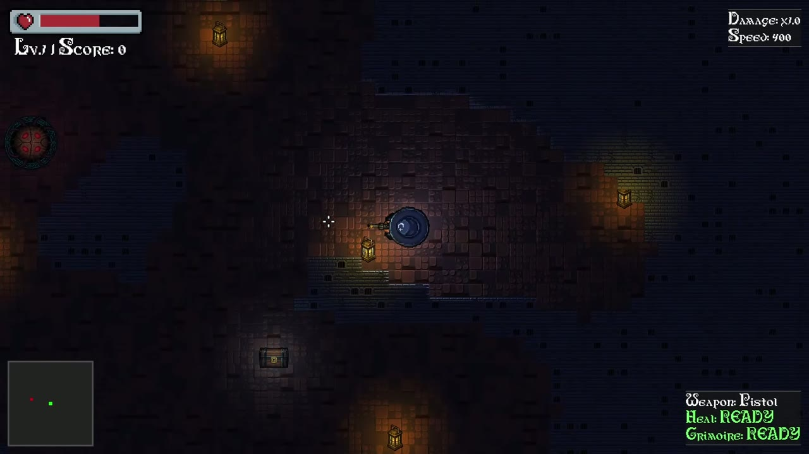
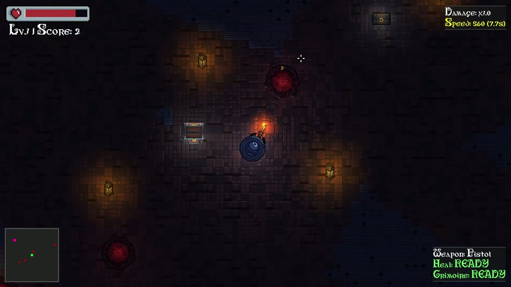
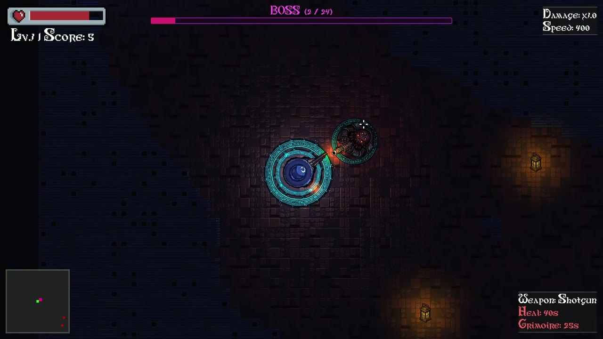
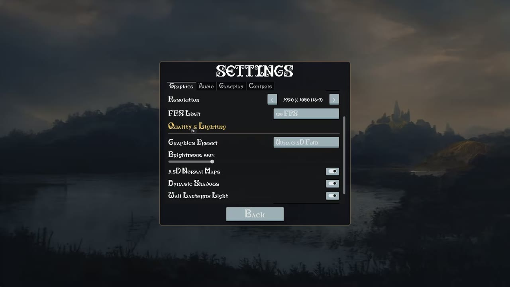

# Gunpowder & Grimoires (v4.1.1)

**Gunpowder & Grimoires** is a dynamic 2.5D top-down dark fantasy rogue-lite shooter built with **Godot Engine 4.6.2**, where enchanted firearms meet arcane grimoires inside procedurally generated dungeons.

🌐 **Project Website & Gameplay Clips:** https://warmoder.github.io/Gunpowder-Grimoires/  
⬇️ **Downloads (Windows / Linux / Android):** [GitHub Releases](https://github.com/Warmoder/Gunpowder-Grimoires/releases)

---

## Screenshots

| 2.5D Dungeon Lighting | Dungeon Combat & Loot |
| :---: | :---: |
|  |  |
| **Boss Fight & Arcane Shield** | **Tabbed Settings & Keybinds** |
|  |  |

*(Watch full looping gameplay clips directly on the [Project Website](https://warmoder.github.io/Gunpowder-Grimoires/#media) or in [`media/`](media/).)*

---

## Highlights (Release 4.0)
- **2.5D Dynamic Lighting:** Normal-mapped dungeon stone, dynamic shadows, flickering wall lanterns, and customizable presets (`Low / Potato` → `Medium` → `Ultra` → `Custom`).
- **60Hz Physics + Physics Interpolation:** Silky-smooth movement and camera look-ahead at any refresh rate (60 / 120 / 144+ Hz).
- **Procedural Multithreaded Dungeons:** Background-threaded map generation with Monolith & Fast Perimeter wall modes, loot chests, escalating difficulty (+20% per floor), and a Boss arena.
- **Boss Battles & HUD Polish:** Boss HP bar, distinct purple boss marker on the minimap, hit-flash feedback, floating damage numbers, pickup notifications, and portal activation banner.
- **Tabbed Settings & Full Key Rebinding:** Separate **Graphics**, **Audio**, **Gameplay**, and **Controls** tabs with interactive key rebinding and default reset.
- **Optimized Performance:** Lightweight additive bullet glow, throttled enemy AI raycasts, OGG Vorbis streaming soundtrack, and Exclusive Fullscreen support.

## Arsenal & Grimoires
- **Weapons (`1` / `2` / `3`, `Tab`, or Mouse Wheel):** Pistol, Piercing Shotgun (5 pellets), Automatic Rifle.
- **Magic:** Heal Spell (`Q`) & Random Grimoire (`E` — Speed Boost, Damage Multiplier, or Arcane Shield).
- **QoL Hotkeys:** `M` (Toggle Minimap), `F11` (Toggle Fullscreen), `Esc` (Pause). All keys are rebindable in **Settings → Controls**.

## Platforms
- **Windows** (`x86_64`, standalone `.exe`)
- **Linux** (`x86_64`, standalone binary)
- **Android** (`ARM64` `.apk` with virtual touch joysticks)

---
*Developed by Anton Beglov on Godot Engine 4.6.2.*
